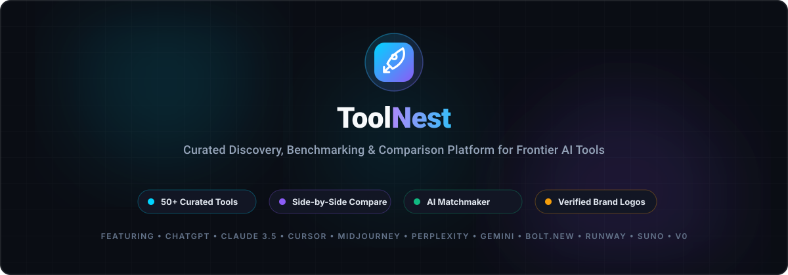

#  ToolNest Client — AI Tools Discovery & Comparison Platform

<div align="center">



### Discover, Compare, & Benchmark 50+ Curated Frontier AI Tools

[](https://tool-nest-client.vercel.app)
[](https://toolnest-server.onrender.com/api)
[](https://nextjs.org/)
[](https://www.typescriptlang.org/)
[](https://tailwindcss.com/)
[](LICENSE)

---

### 👨‍💻 Connect with Developer (Atahar Shihab)

[](mailto:shihabatahar@gmail.com)
[](https://github.com/Atahar-Shihab)
[](https://www.linkedin.com/in/atahar-shihab)
[](https://www.facebook.com/atahar.shihab.740192/)

</div>

---

## 📖 Overview

**ToolNest** is a modern, high-performance web platform designed to discover, benchmark, compare, and review top curated artificial intelligence tools across 8 major domains: **Productivity, Coding, Design, Video, Music, Writing, Marketing, and Research**.

Built with Next.js 16 (App Router + Turbopack), React 19, TypeScript, and Tailwind CSS v4, ToolNest delivers a fluid, dark-first glassmorphism user experience with instantaneous search filtering, interactive goal-based tool matching, side-by-side technical comparisons, and full administrative moderation.

---

## 🌟 Core Features

### 🏠 1. Landing Page & Interactive Ecosystem
- **Live Trending AI Tool Swiper**: Continuous 2-row bi-directional marquee running on GPU-accelerated CSS keyframes with automatic hover-to-pause and instant directory filtering.
- **Responsive Hero Search**: Mobile-optimized search input with real-time text clearing (`X`), popular trending tags (*ChatGPT, Cursor, Claude, Midjourney, Bolt.new*), and category quick-filters.
- **Interactive AI Matchmaker**: 3-second objective wizard recommending tailored top-3 tools for coding, design, research, marketing, and video creation with engine specifications and share links.
- **Zero-FOUC Theme Engine**: Synchronous `<head>` script detection preventing light/dark theme flash on server-side rendering while honoring user preference.

### 🔍 2. AI Directory & Rich Metadata (`/tools`)
- **Multi-Parameter Filter Grid**: Filter in real time by keyword search, category, pricing tier (*Free Plan, Free Trial, Paid*), and sort order (*Newest, Highest Rated, Most Bookmarked, A-Z*).
- **Verified Real Brand Pictures**: Every tool card features authentic, verified brand logos delivered via high-speed global CDN, presented on floating glassmorphism preview tiles with monogram fallback resilience.
- **Comprehensive Tool Specifications (`/tools/[id]`)**: Detailed breakdown of:
  - 🤖 **Underlying AI Model**: e.g., *GPT-4o, Claude 3.5 Sonnet, OpenAI o1, Gemini 2.0 Flash, Midjourney v6.1*
  - 🏢 **Company & Founding Team**: Origin history, launch year, and founding context
  - 🏷️ **Feature Checklist**: Core technical and creative capabilities
  - 🌐 **Direct Verified URLs**: Official links to tool web apps

### ⚖️ 3. Side-by-Side Comparison Matrix (`/compare`)
- Compare any two AI tools head-to-head across pricing models, model architectures, company backgrounds, and community ratings.
- Quick "Compare" shortcut buttons embedded directly on tool cards and tool detail pages.

### 🛡️ 4. Secure Route-Guarded Dashboards (`/dashboard`)
- **Session Authentication Guard**: Strict layout-level protection redirecting unauthenticated visitors immediately to `/login` with smooth loading states.
- **User Dashboard**: Submit new tools, manage pending/approved submissions, view personal reviews, and organize saved bookmarks.
- **Admin Management Suite**:
  - **Tool Moderation**: Review pending submissions and approve or reject with custom feedback reasons.
  - **Review Moderation**: Monitor and delete reviews with real-time average star recalculation.
  - **User Role Management**: Elevate or demote user permissions (`user` ↔ `admin`).
  - **Visual Analytics Dashboard**: Recharts-powered distribution and category rating charts.

### 💳 5. Pro Membership & Payments (`/payment`)
- Integrated Stripe Elements checkout supporting one-time lifetime Pro upgrades ($5.00) with encrypted 256-bit payment processing.

---

## 🖥️ Page & Route Map

| Route | View Description | Core Capabilities |
| :--- | :--- | :--- |
| `/` | 🏠 **Landing Page** | Hero search, trending marquee swiper, interactive AI Matchmaker, stats counter, FAQs |
| `/tools` | 🔎 **Directory Page** | Search, category filters, pricing filters, pagination, sort controls, brand logo tiles |
| `/tools/[id]` | 📋 **Tool Detail Page** | Full specs, AI model details, company history, interactive review form, bookmark toggle, similar tools |
| `/compare` | ⚖️ **Comparison Matrix** | Side-by-side diffing of any two AI tools |
| `/login` | 🔑 **Sign In** | Email/password login, demo account shortcut, Google OAuth 2.0 |
| `/register` | 📝 **Registration** | Account creation with form validation, Google OAuth 2.0 |
| `/dashboard` | 📊 **User Dashboard** | Submission status, tool metrics, recent activity (Route-Guarded) |
| `/dashboard/add-tool` | ➕ **Tool Submission** | Multi-field application with tag and feature chip management |
| `/dashboard/my-tools` | 🛠️ **My Submissions** | Edit, delete, and view approval status of user-submitted tools |
| `/dashboard/bookmarks` | 🔖 **Saved Tools** | Quick-access grid of bookmarked tools |
| `/dashboard/admin/*` | 🛡️ **Admin Suite** | All Tools, Analytics charts, Review Moderation, User Roles (Admin RBAC) |
| `/payment` | 💳 **Pro Upgrade** | Stripe PaymentIntent checkout |
| `/about` | 👤 **About Developer** | Lead developer profile, story, and social links |
| `/contact` | ✉️ **Contact Form** | Direct message submission interface |

---

## 🛠️ Technology Stack

```
Frontend:     Next.js 16 (App Router + Turbopack) • React 19 • TypeScript
Styling:      Tailwind CSS v4 • Custom Glassmorphism Token System
Animation:    Framer Motion • CSS GPU-Accelerated Keyframes
Icons:        Lucide React
Data Viz:     Recharts
HTTP Client:  Axios (with JWT Bearer interceptor & auto-logout on expiry)
Auth:         @react-oauth/google • JWT Token Storage
Payments:     @stripe/stripe-js • @stripe/react-stripe-js
Hosting:      Vercel
```

---

## 🚀 Getting Started

### Prerequisites
- Node.js 18.17+ or 20+
- npm or pnpm or yarn

### 1. Clone the Repository
```bash
git clone https://github.com/Atahar-Shihab/ToolNest_Client.git
cd ToolNest_Client
```

### 2. Configure Environment Variables
Create a `.env.local` file in the root folder:
```env
NEXT_PUBLIC_API_URL=https://toolnest-server.onrender.com/api
NEXT_PUBLIC_STRIPE_PUBLISHABLE_KEY=pk_test_your_stripe_publishable_key
NEXT_PUBLIC_GOOGLE_CLIENT_ID=your_google_client_id.apps.googleusercontent.com
```

### 3. Install Dependencies & Run
```bash
npm install
npm run dev
```
Open [http://localhost:3000](http://localhost:3000) in your browser.

### 4. Production Build
```bash
npm run build
npm run start
```

---

## 🔑 Demo Access Credentials

| Role | Email | Password | Permissions |
| :--- | :--- | :--- | :--- |
| **Standard User** | `user@toolnest.com` | `User123!` | Submit tools, post reviews, bookmark tools, upgrade to Pro |
| **Admin User** | `admin@toolnest.com` | `Admin123!` | Full access + approve/reject submissions, delete reviews, user RBAC, analytics |

> **Tip:** You can also click the **"Try Demo Account"** button on the `/login` page to auto-fill and test immediately.

---

## 📬 Developer Contact

Developed with passion by **Atahar Shihab**:
- 📧 **Email**: [shihabatahar@gmail.com](mailto:shihabatahar@gmail.com)
- 🐙 **GitHub**: [github.com/Atahar-Shihab](https://github.com/Atahar-Shihab)
- 💼 **LinkedIn**: [linkedin.com/in/atahar-shihab](https://www.linkedin.com/in/atahar-shihab)
- 📘 **Facebook**: [facebook.com/atahar.shihab.740192](https://www.facebook.com/atahar.shihab.740192/)

License: [MIT](LICENSE)
